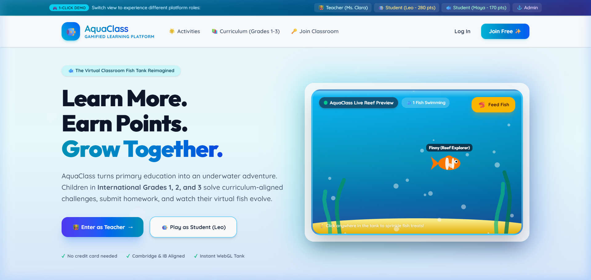
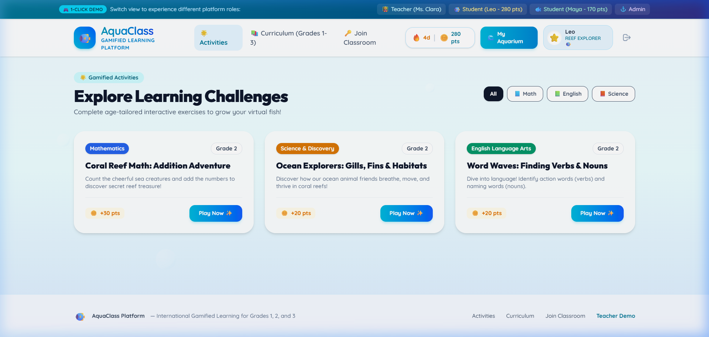
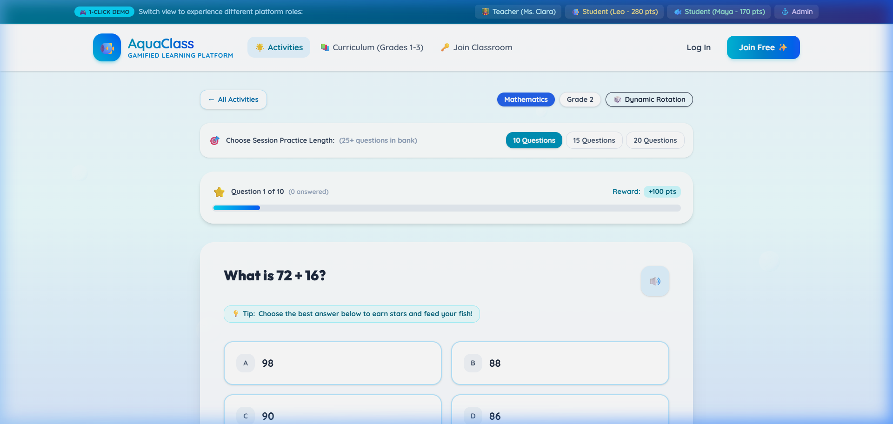
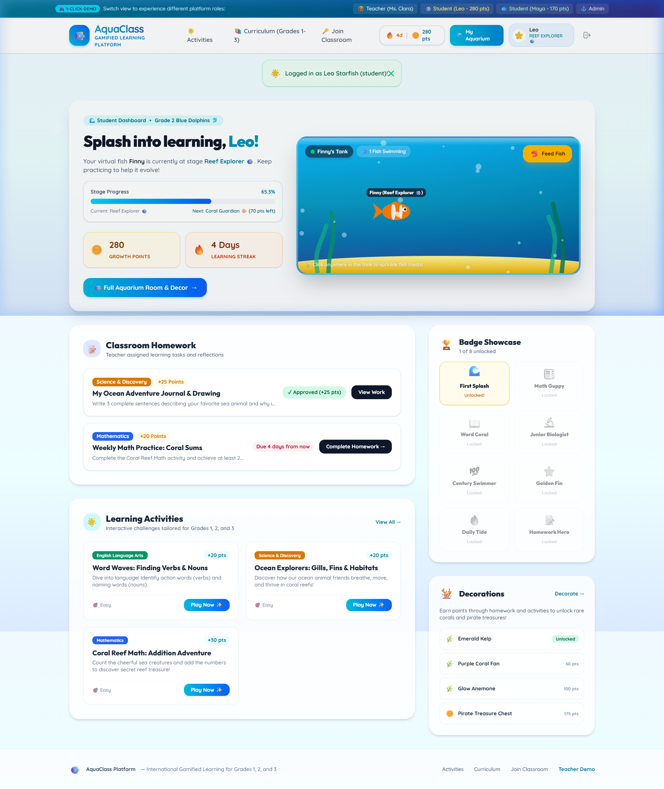
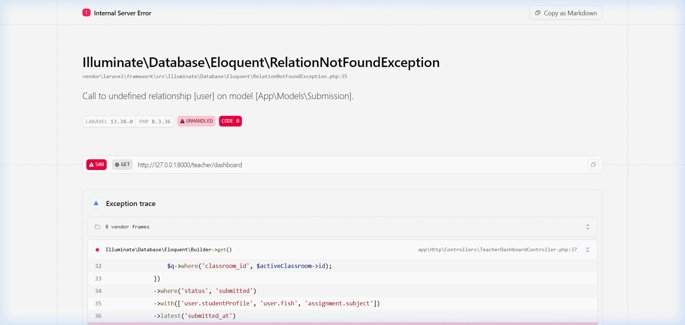
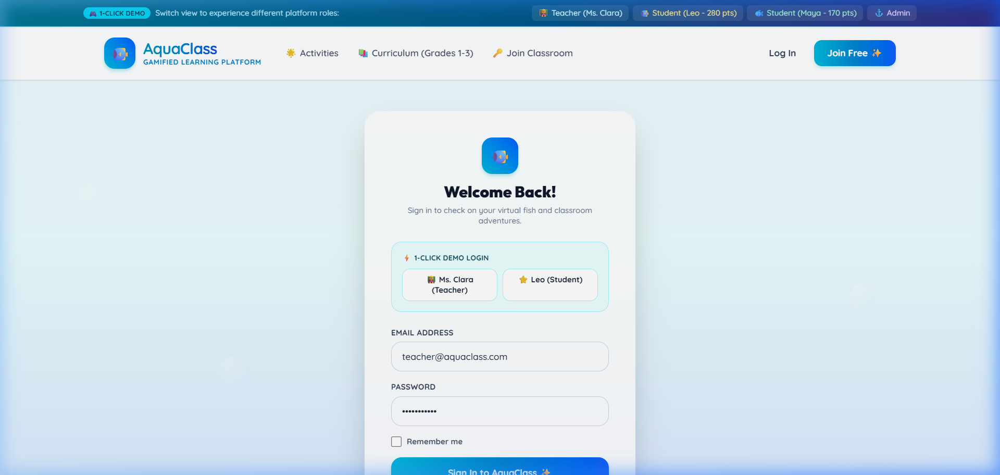

# 🌊 AquaClass

<p align="center">
  
</p>

<p align="center">
  <strong>AquaClass — Learn More. Earn Points. Grow Together.</strong><br>
  <em>A gamified marine educational platform tailored for international Grade 1–3 learners, combining interactive quizzes, dynamic question rotation, and an evolving virtual aquarium.</em>
</p>

<p align="center">
  <a href="https://aquaclass-nine.vercel.app"></a>
  <a href="https://laravel.com"></a>
  <a href="https://php.net"></a>
  <a href="https://supabase.com"></a>
  <a href="https://tailwindcss.com"></a>
  <a href="https://alpinejs.dev"></a>
  <a href="LICENSE"></a>
</p>

---

## 🌐 Live Production Deployment

AquaClass is publicly deployed and accessible on HTTPS via Vercel with serverless PHP and cloud Supabase PostgreSQL:

- **Official Live Site**: [https://aquaclass-nine.vercel.app](https://aquaclass-nine.vercel.app)
- **Direct Activities Portal**: [https://aquaclass-nine.vercel.app/activities](https://aquaclass-nine.vercel.app/activities)
- **1-Click Live Roles**: Experience live student dashboards, classroom leaderboards, and teacher portals without manual setup via the demo role switcher banner!

---

## 📋 Table of Contents

1. [Overview & Educational Purpose](#-overview--educational-purpose)
2. [Key Features](#-key-features)
3. [Visual Showcase](#-visual-showcase)
4. [Dynamic Question Rotation System](#-dynamic-question-rotation-system)
5. [Curriculum & Question Bank Coverage](#-curriculum--question-bank-coverage)
6. [Virtual Aquarium & Gamification](#-virtual-aquarium--gamification)
7. [Technology Stack](#-technology-stack)
8. [Architecture & Project Structure](#-architecture--project-structure)
9. [Local Development Setup](#-local-development-setup)
10. [Database Configuration & Migrations](#-database-configuration--migrations)
11. [Automated Testing & QA](#-automated-testing--qa)
12. [Production Deployment](#-production-deployment)
13. [Security & Credential Hygiene](#-security--credential-hygiene)
14. [License & Acknowledgments](#-license--acknowledgments)

---

## 🐬 Overview & Educational Purpose

**AquaClass** transforms early childhood education into an aquatic exploration adventure for primary school children (Ages 6–9, Grades 1–3). Aligned with international **Cambridge Primary** and **IB Primary Years (PYP)** curriculum standards, the platform fosters foundational mastery in **Mathematics**, **English Language Arts**, and **Science & Discovery**.

Unlike repetitive quiz apps, AquaClass features an **intelligent repeat-avoidance question selection engine** backed by a **300+ question bank** and an **evolving virtual aquarium** where homework completion, quiz accuracy, and daily streaks directly feed and grow the student's personal pet fish.

---

## 🌟 Key Features

- 🐠 **Gamified Virtual Aquarium**:
  - Every student nurtures a companion fish (Clownfish, Blue Tang, Yellow Tang, Angelfish).
  - 4 developmental growth stages: `Tiny Fry` $\rightarrow$ `Little Swimmer` $\rightarrow$ `Reef Explorer` $\rightarrow$ `Coral Guardian`.
  - Unlockable aquarium decorations: castles, coral fans, kelp forests, sunlit lagoons, and sunken ships.

- 🎲 **Dynamic Question Rotation & Practice Modes**:
  - Select practice sessions of **10 Questions** (default), **15 Questions** (standard), or **20 Questions** (extended).
  - **Repeat Avoidance**: Automatically prioritizes previously unseen questions on repeat attempts (0% question overlap on consecutive 10-question sessions).
  - Recency-weighted recycling ensures older questions are revisited only after the full question pool is explored.
  - Option randomization shuffles `A, B, C, D` choices to prevent pattern memorization while preserving server-side answer integrity.

- 📚 **Comprehensive 300+ Question Bank**:
  - 12 active learning sections covering all 12 curriculum learning objectives across Grades 1 to 3.
  - 25 curriculum-vetted, age-appropriate questions with 4 distinct options and educational explanations per section.

- 🔊 **Accessibility & Child-Friendly Interaction**:
  - Web Audio API real-time chime feedback (`pop`, `cheer`, `bubble`).
  - Web Speech API integration with one-click **Text-to-Speech (Read Aloud 🔊)** on every question.
  - High-contrast, clean ocean-glass design system with intuitive visual navigation.

- 👨‍🏫 **Teacher & Classroom Management**:
  - Classroom creation with 6-character alphanumeric join codes (e.g. `AQUA202`).
  - Real-time student progress tracking, points ledger audit, and classroom leaderboard controls.
  - Homework and assignment creation with reward point allocation.

- 🔐 **Dual Authentication & Instant Role Switching**:
  - Google OAuth 2.0 single sign-on integration.
  - One-click instant role switcher in the header to effortlessly preview Teacher, Student (Leo, Maya, Kai), and Admin perspectives.

---

## 📸 Visual Showcase

### 1. Interactive Landing Page
*Warm, welcoming ocean-glass UI greeting students and educators.*


### 2. Activities & Curriculum Catalog
*Filterable by Grade (1, 2, 3) and Subject (Math, English, Science) with live question pool stats.*


### 3. Dynamic Practice Quiz with Rotation
*Includes session length toggles (10Q, 15Q, 20Q), Text-to-Speech audio, and randomized options.*


### 4. Student Aquarium & Progress Dashboard
*Gamified dashboard showing virtual fish growth, daily streaks, weekly goals, and unlocked cosmetics.*


### 5. Teacher Classroom Portal
*Comprehensive classroom oversight, member tracking, join code distribution, and assignment reviews.*


### 6. Authentication & Student Demo Login
*Seamless sign-in with Google OAuth or instant single-click demo profiles.*


---

## 🎲 Dynamic Question Rotation System

The question selection engine (`QuizSessionService`) prevents student boredom by dynamically rotating questions across sessions:

```
                      [ Student Starts Activity ]
                                   │
                                   ▼
                   [ Check Attempt History in DB ]
                                   │
        ┌──────────────────────────┴──────────────────────────┐
        ▼                                                     ▼
 [ Unseen Questions Pool ]                             [ Seen Questions Pool ]
 (Never attempted by student)                        (Sorted by oldest seen_at)
        │                                                     │
        ▼ (Priority 1)                                        ▼ (Priority 2)
Take up to Target Length (10, 15, or 20)            Fills remainder if needed
        │                                                     │
        └──────────────────────────┬──────────────────────────┘
                                   │
                                   ▼
                  [ Shuffle Question Display Order ]
                                   │
                                   ▼
             [ Shuffle Multiple Choice Options (A, B, C, D) ]
                                   │
                                   ▼
             [ Generate Secure QuizSession & Session Token ]
```

### Server-Side Answer Evaluation & Idempotency
- Quiz attempts are tied to a cryptographically secure `session_token`.
- Answer verification occurs exclusively on the server, ensuring students cannot manipulate scores via client scripts.
- Re-submitting an already-completed session is strictly idempotent and prevents duplicate reward points.

---

## 📚 Curriculum & Question Bank Coverage

| Grade Level | Subject | Section / Activity Title | Curriculum Objective Topic | Question Pool | Options |
| :--- | :--- | :--- | :--- | :---: | :---: |
| **Grade 1** | Mathematics | *Counting Seashells: Numbers 1 to 20* | Counting & Number Sense | **25** | 100 |
| **Grade 1** | Mathematics | *Tide Pool Math: Addition within 10* | Simple Addition within 10 | **25** | 100 |
| **Grade 1** | English | *Seashore Phonics: Short Vowels & Sounds* | Phonics & Short Vowels | **25** | 100 |
| **Grade 1** | Science | *Tidepool Wonders: Living vs Non-Living* | Living vs Non-Living | **25** | 100 |
| **Grade 2** | Mathematics | *Coral Reef Math: Addition Adventure* | Two-Digit Addition | **25** | 100 |
| **Grade 2** | Mathematics | *Splash & Pair: Odd and Even Sea Numbers* | Odd & Even Sea Numbers | **25** | 100 |
| **Grade 2** | English | *Word Waves: Finding Verbs & Nouns* | Nouns, Verbs & Adjectives | **25** | 100 |
| **Grade 2** | Science | *Ocean Explorers: Gills, Fins & Habitats* | Ocean Habitats & Adaptations | **25** | 100 |
| **Grade 3** | Mathematics | *Dolphin Multiplication: 2, 5 & 10 Tables* | Multiplication Tables (2, 5, 10) | **25** | 100 |
| **Grade 3** | Mathematics | *Treasure Fractions: Halves, Thirds & Fourths* | Introduction to Fractions | **25** | 100 |
| **Grade 3** | English | *Deep Sea Stories: Reading & Inferences* | Reading Comprehension & Inferences | **25** | 100 |
| **Grade 3** | Science | *Cloud to Ocean: Water Cycle & Weather* | The Water Cycle & Weather | **25** | 100 |
| **TOTALS** | **3 Subjects** | **12 Complete Learning Sections** | **12 Global Standards** | **300** | **1,200** |

---

## 🐠 Virtual Aquarium & Gamification

```
┌─────────────────┐      150 pts      ┌─────────────────────┐
│    Tiny Fry     │ ────────────────> │   Little Swimmer    │
│  (0 - 149 pts)  │                   │   (150 - 299 pts)   │
└─────────────────┘                   └─────────────────────┘
                                                 │
                                                 │ 300 pts
                                                 ▼
┌─────────────────┐      500 pts      ┌─────────────────────┐
│ Coral Guardian  │ <──────────────── │    Reef Explorer    │
│   (500+ pts)    │                   │   (300 - 499 pts)   │
└─────────────────┘                   └─────────────────────┘
```

- **Point Ledger**: Every star and coin earned is written as an immutable `PointTransaction` record.
- **Streak Multipliers**: Practicing daily maintains a continuous streak fire 🔥, encouraging consistent study habits.
- **Customization**: Students customize fish colors, stage forms, and placed underwater decorations.

---

## 🛠️ Technology Stack

| Layer | Technologies & Tools |
| :--- | :--- |
| **Backend Framework** | Laravel 11.x, PHP 8.2+ |
| **Frontend Architecture** | Blade Components, TailwindCSS 3.4, Alpine.js 3.x |
| **Database** | PostgreSQL 15+ (Hosted on Supabase Cloud) |
| **Authentication** | Laravel Session Auth, Google OAuth 2.0 (Socialite) |
| **Media & Audio** | HTML5 Web Audio API, Web Speech API (TTS) |
| **Testing** | PHPUnit 11, Laravel Testbench |
| **Serverless Deployment** | Vercel Serverless PHP Runtime (`vercel-php@0.7.3`) |
| **Asset Pipeline** | Vite 8, PostCSS, Autoprefixer |

---

## 📂 Architecture & Project Structure

```
aquaclass/
├── app/
│   ├── Http/
│   │   └── Controllers/
│   │       ├── ActivityController.php      # Quiz sessions & evaluations
│   │       ├── AuthController.php          # Login, registration, role switcher
│   │       ├── GoogleAuthController.php    # Google OAuth 2.0 callback
│   │       ├── StudentController.php       # Student aquarium & dashboard
│   │       └── TeacherController.php       # Classrooms & homework management
│   ├── Models/
│   │   ├── LearningActivity.php            # Learning activity catalog model
│   │   ├── ActivityQuestion.php            # Question item & correct answers
│   │   ├── ActivityOption.php              # MCQ options & correctness flag
│   │   ├── ActivityAttempt.php             # Individual student attempt logs
│   │   ├── QuizSession.php                 # Dynamic practice session tracking
│   │   ├── Fish.php & FishStage.php        # Virtual aquarium evolution models
│   │   ├── Classroom.php                   # Teacher-student classroom entity
│   │   └── PointTransaction.php            # Immutable points ledger
│   └── Services/
│       ├── QuizSessionService.php          # Rotation, repeat avoidance & scoring
│       └── PointService.php                # Gamification points & fish upgrades
├── database/
│   ├── migrations/                         # 8 versioned, safe database migrations
│   └── seeders/
│       ├── DatabaseSeeder.php              # Master orchestration seeder
│       ├── CurriculumSeeder.php            # Frameworks, subjects & objectives
│       ├── AquariumSeeder.php              # Fish species, stages & decorations
│       ├── AchievementSeeder.php           # Badges & gamification rewards
│       ├── AquaClassDemoSeeder.php         # Teacher & student demo accounts
│       └── QuestionBankSeeder.php          # 300 questions across 12 sections
├── resources/
│   ├── views/
│   │   ├── activities/
│   │   │   ├── index.blade.php             # Catalog with Grade/Subject filters
│   │   │   └── play.blade.php              # Interactive quiz runner & review
│   │   ├── student/                        # Student aquarium & profile views
│   │   ├── teacher/                        # Teacher classroom views
│   │   └── components/layouts/             # App shell, navbars & audio engine
├── screenshots/                            # Genuine high-resolution application screenshots
├── tests/
│   └── Feature/
│       ├── AquaClassCoreTest.php           # Core auth, points & role switching
│       └── QuestionRotationTest.php        # Session lengths & repeat avoidance
└── vercel.json                             # Vercel serverless PHP deployment config
```

---

## 🚀 Local Development Setup

### 1. Prerequisites
- **PHP 8.2 or higher** with `pdo_pgsql`, `pgsql`, `mbstring`, `openssl`, and `curl` extensions enabled.
- **Composer 2.x**
- **Node.js 18+ & npm**
- **PostgreSQL 14+** (or a free [Supabase](https://supabase.com) project)

### 2. Clone the Repository
```bash
git clone https://github.com/AvengerNabil/AquaClass.git
cd AquaClass
```

### 3. Install Backend & Frontend Dependencies
```bash
composer install
npm install
```

### 4. Configure Environment Variables
Copy the sanitized template to `.env`:
```bash
cp .env.example .env
php artisan key:generate
```

Update your `.env` database parameters:
```env
DB_CONNECTION=pgsql
DB_HOST=aws-0-ap-southeast-1.pooler.supabase.com
DB_PORT=5432
DB_DATABASE=postgres
DB_USERNAME=postgres.your-project-ref
DB_PASSWORD=your-database-password
DB_SSLMODE=require
```

### 5. Run Database Migrations & Seeders
Execute the migrations and seed the complete 300-question bank along with demo classrooms:
```bash
php artisan migrate
php artisan db:seed
```

### 6. Build Assets and Start Local Server
```bash
npm run build
php artisan serve
```
Open **[http://127.0.0.1:8000](http://127.0.0.1:8000)** in your browser!

---

## 🗄️ Database Configuration & Migrations

AquaClass uses structured migrations designed for PostgreSQL:
1. `0001_01_01_000000_create_users_table.php` — Users, roles (`teacher`, `student`, `admin`), sessions, cache.
2. `2024_01_01_000001_create_curriculum_tables.php` — Frameworks, grade levels, subjects, standards, objectives.
3. `2024_01_01_000002_create_learning_activity_tables.php` — Activities, questions, options, attempts.
4. `2024_01_01_000003_create_classroom_tables.php` — Classrooms, join codes, members.
5. `2024_01_01_000004_create_assignment_tables.php` — Assignments, submissions, grading.
6. `2024_01_01_000005_create_student_profiles_table.php` — Student profiles, streaks, weekly targets.
7. `2024_01_01_000006_create_aquarium_tables.php` — Fish species, evolution stages, decorations.
8. `2024_01_01_000007_create_achievements_and_system_tables.php` — Badges, points ledger, audit logs.
9. `2024_01_01_000008_create_quiz_sessions_table.php` — Quiz sessions, dynamic question ID arrays, completion state.

---

## 🧪 Automated Testing & QA

AquaClass includes an automated PHPUnit test suite validating authentication, point calculation, fish growth, session length handling, option shuffling, and repeat avoidance:

```bash
php artisan test
```

### Verification Results
```
   PASS  Tests\Feature\AquaClassCoreTest
  ✓ landing page loads with stages
  ✓ demo switcher switches to teacher
  ✓ demo switcher switches to student
  ✓ point service advances fish growth
  ✓ student can view their aquarium
  ✓ classroom join code connects student
  ✓ teacher can create assignment
  ✓ student submission awards points
  ✓ achievement unlocks upon streak target
  ✓ guest can view public activities catalog

   PASS  Tests\Feature\QuestionRotationTest
  ✓ activity provides 10 15 and 20 questions
  ✓ dynamic question rotation prefers unseen questions
  ✓ options are shuffled and answers accurate
  ✓ session submission is idempotent

  Tests:    14 passed (61 assertions)
  Duration: 2.01s
```

---

## ☁️ Production Deployment

AquaClass is optimized for zero-cold-start deployment on **Vercel** with the `vercel-php` serverless runtime:

1. **Vercel Entrypoint**: `api/index.php` routes requests through the Laravel application kernel, dynamically directing writable storage (`sessions`, `views`, `logs`) to `/tmp/storage`.
2. **Build Configuration**: `vercel.json` configures the static asset mapping for `public/build` Vite bundles and API routing.
3. **Environment Setup**: Set `APP_KEY`, `DB_CONNECTION=pgsql`, `DB_HOST`, `DB_PASSWORD`, and `SUPABASE_*` credentials in the Vercel Project Settings.

---

## 🔐 Security & Credential Hygiene

- **Zero Secrets Tracked**: `.env`, database passwords, Google client secrets, and service-role keys are excluded from git history via `.gitignore`.
- **Server-Side Scoring**: Correct answer evaluation is performed server-side; client payloads never reveal scoring logic before submission.
- **CSRF & Session Protection**: All forms and API endpoints validate CSRF tokens and sanitize user answers.
- **SQL Injection Prevention**: Eloquent ORM parameterized queries are used throughout.

---

## 📄 License & Acknowledgments

This project is open-sourced under the **[MIT License](LICENSE)**.

- **Author**: [AvengerNabil](https://github.com/AvengerNabil)
- **Tagline**: *AquaClass — Learn More. Earn Points. Grow Together.*
- **Icons & Audio**: Crafted with Lucide Icons and HTML5 Web Audio synthesis.
